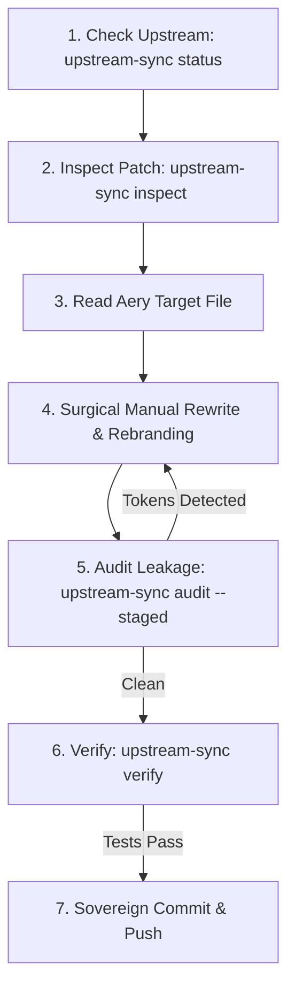

# Managing Upstream Syncs (Sovereign Aery Protocol)

You are operating within the **Aery** architecture. Aery is an independent, sovereign hard-fork of the Pi/Kimchi repository with its own native branding, packages (`@eminent337/aery`), and custom architecture (Graph Engine, Swarm Coordinator, Skill Hub, and Live Compactor).

---

## 🚫 The Cardinal Rule: Zero Automated Merges

1. **NEVER AUTO-MERGE**: You are strictly forbidden from running `git merge upstream/main`, `git pull upstream`, or `git cherry-pick`.
2. **MANUAL / SURGICAL PORTING ONLY**: Because Aery has extensively customized namespaces and sovereign packages, automated merges cause catastrophic merge conflicts, dependency breakages, and branding leaks.
3. **READ-ONLY UPSTREAM**: Upstream remotes exist purely as read-only reference oracles.

---

## 🛡️ The 5 Sovereign Pillars

1. **Keep Remotes Read-Only**: `git fetch upstream` (or `omp`, `jcode`) is purely for reading upstream improvements. Never push to upstream or merge branches directly.
2. **The "Surgical Agent" Workflow**: Extract the exact diff from the upstream commit (`git show <sha>`), understand the intent, locate the corresponding target file in Aery, and perform a manual, surgical port.
3. **Meticulous Rebranding (Zero Leakage)**: Actively translate all upstream terminology into Aery equivalents. You are strictly forbidden from introducing upstream identifiers (`kimchi`, `getkimchi`, `pi-mono`, `oh-my-pi`) into Aery source code.
4. **Automated Audit**: Before committing any ported code, run `upstream-sync audit` to verify zero forbidden tokens were introduced.
5. **Zero-Error Guarantee**: Every port must compile (`bun run check:ts`) and pass tests (`bun run test`) with zero errors.

---

## 🧭 Remotes Topology

In the Aery repository (`ai_agent/aery`), standard remotes are configured as:

| Remote | Repository | Purpose |
|---|---|---|
| `origin` | `https://github.com/eminent337/aery.git` | Sovereign Aery main repository (read/write). |
| `upstream` | `https://github.com/getkimchi/kimchi.git` | Base upstream Pi/Kimchi mono-repo (read-only reference). |
| `omp` | `https://github.com/can1357/oh-my-pi.git` | Upstream Oh-My-Pi enhancements (read-only reference). |
| `jcode` | `https://github.com/1jehuang/jcode.git` | Upstream Jcode architecture (read-only reference). |

---

## 🔄 Rebranding & Translation Matrix

When porting any feature or bugfix, translate tokens according to this table:

| Upstream Token | Aery Native Equivalent |
|---|---|
| `kimchi`, `Kimchi` | `aery`, `Aery` |
| `getkimchi` | `eminent337` |
| `@getkimchi/core` | `@eminent337/aery` (or localized package) |
| `packages/kimchi/` | `packages/coding-agent/` |
| `pi-mono` | `aery` |
| `oh-my-pi`, `omp` | `aery` |
| `~/.kimchi/` | `~/.aery/` |
| `kimchi.json` | `aery.json` |

---

## 🛠️ Upstream Sync CLI Tool (`scripts/upstream-sync`)

The skill includes a dedicated helper tool located at `scripts/upstream-sync`:

### 1. Check Upstream Status & Recent Commits
Fetches the upstream remote quietly and lists the latest commits without altering your local working directory:
```bash
upstream-sync status [--remote upstream|omp|jcode] [-n 10]
```

### 2. Inspect a Commit for Porting
Displays commit summary, changed files, and automatically suggests the corresponding target paths in Aery:
```bash
upstream-sync inspect <commit-sha>
```

### 3. Rebranding & Token Leakage Audit
Scans modified files or staged git changes for any accidental upstream token leaks (`kimchi`, `pi-mono`, etc.):
```bash
# Audit working tree changes
upstream-sync audit

# Audit staged changes before committing
upstream-sync audit --staged

# Audit specific files or directories
upstream-sync audit packages/coding-agent/src/
```

### 4. Verification Check
Runs the local typecheck and test suite to confirm the Zero-Error Guarantee:
```bash
upstream-sync verify
```

---

## 📋 Step-by-Step Porting Lifecycle



1. **Identify Upstream Need**:
   Run `upstream-sync status` to view latest upstream fixes or specify a target commit/PR.
2. **Inspect the Patch**:
   Run `upstream-sync inspect <sha>` and `git show <sha>` to understand what logic was changed.
3. **Locate & Read Aery Counterpart**:
   Check the corresponding file in `packages/coding-agent/src/` or native crates.
4. **Surgically Apply & Rebrand**:
   Manually implement the fix or feature using Aery conventions, types, and styling.
5. **Run Rebranding Audit**:
   `upstream-sync audit --staged` guarantees no `kimchi` or `pi-mono` references slip through.
6. **Execute Verification**:
   `bun run check:ts && bun run test` to guarantee 0 compiler errors and 0 test regressions.
7. **Commit & Push**:
   Commit with a clear message referencing the ported functionality natively for Aery.
